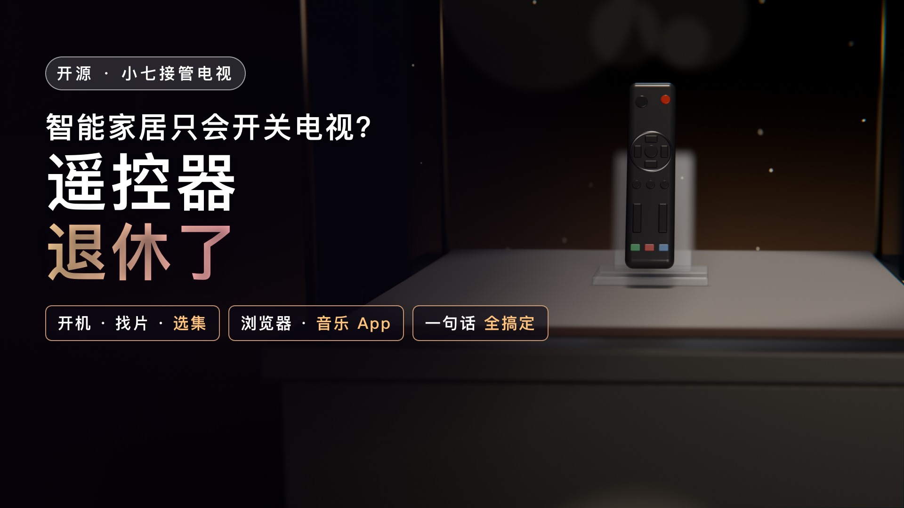
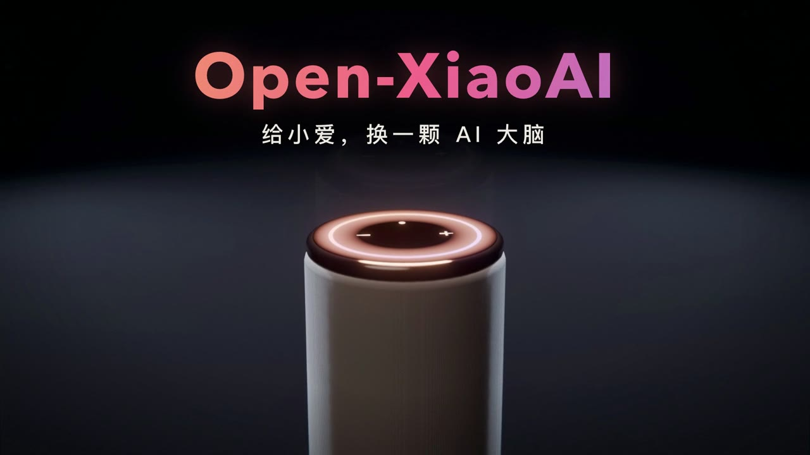

> [!NOTE]
> **维护状态：活跃更新中。** 本项目最初 Fork 自 [idootop/open-xiaoai](https://github.com/idootop/open-xiaoai)（原项目已归档），现已从小爱音箱改造项目演进为一套**开源、本地优先的家庭 AI 智能管家系统**。每天在真实家庭中运行：客厅的小爱音箱、书房的蓝牙音箱、两路海康摄像头、客厅 TCL 电视、16 台跨品牌家电与手机 QQ 均接入同一套家庭大脑（内置轻量语音网关 + Hermes Agent + Home Assistant）。

# Open-XiaoAI · 小七 — 开源家庭 AI 智能管家

**开源、本地优先的家庭 AI 智能管家：任意带麦克风的音箱就能接入，统一接管跨品牌家电、安卓电视与摄像头，能记住习惯、用说话学规矩，在家主动开口、出门 QQ 随时联系。**


## 不只是音箱：给家装一颗 AI 大脑

家里装了不少智能设备，用起来却依然割裂：智能音箱大多困在「指令-响应」的牢笼里，只会执行预设命令、不会主动思考；米家、海尔等不同品牌各用一个 App；电视离不了遥控器；摄像头只管存录像，不参与家里的联动。

**真正的家庭智能不应被单个硬件或厂商生态所束缚，而应像生命体般在日常交互中进化。**

现在，用家里一台常开的普通电脑 / mini PC 作为大脑，串联内置轻量语音网关（[`voice-gateway`](deploy/voice-gateway/README.md)）、[Hermes Agent](https://github.com/NousResearch/hermes-agent)、[Home Assistant](https://www.home-assistant.io/) 与本地视觉模型，再把家里已有的硬件接成感官和手脚。住在你家里的 AI 管家“小七”：

- **不挑语音硬件**：不只支持小爱音箱，任意带麦克风的蓝牙音箱、USB 麦克风 + 音箱（免刷机）、兼容小智协议的 ESP32 语音硬件都能接入；唤醒和语音识别全部在家里本地 ONNX 完成，声音不出家门。
- **会聊天、记得住**：什么都能问，唤醒一次就能一直聊下去；她说话时喊一声“你好小七”就停下听你的（小爱音箱），说“拜拜”马上结束；能联网查证，也能把你的习惯写进长期记忆。
- **管全屋、会查账**：通过 Home Assistant 统一控制米家、海尔智家等跨品牌设备；说一句话真的执行，没执行成功不会乱答；还能查历史账本，“鱼缸灯今天亮了多久”“书房灯是谁关的”一问便知。
- **会安排、能学会**：“两个小时后关鱼缸灯”，到点自己执行；“以后我说‘我回来了’，就开客厅灯”，教一次就记住；“洗衣机洗完了提醒我”，它自己去盯，并带安全风险边界。
- **会放歌、会管电视**：电脑里的本地曲库直接离线放歌，不联网、不用会员；客厅安卓电视也能深度接管，找片、选集、快进、调音量、读屏点击一句话搞定。
- **会看家**：普通 RTSP 摄像头接入 Home Assistant，CPU 跑一个 3.6 MB 的轻量人物检测模型，不用显卡；拍到人自动记录与 1080p 抓拍、网页回看、触发家庭联动。
- **在家会开口，出门 QQ 随时管**：家里有事通过音箱主动播报（遵守勿扰时段，漏水等安全报警例外）；人不在家也能发 QQ 私聊小七查状态、控设备，漏水、低电量、摄像头断流、连廊有人抓拍自动推到 QQ。

**不用打开 App，不用写自动化，也没有预设的场景。** 每家的规矩不一样，全部由你用对话教会它。

## 多种交互入口：不挑音箱，出门也能用

仓库因历史渊源保留了 `open-xiaoai` 的名称，并对小爱音箱保留了最深度的原生支持；但在架构上，**小爱音箱只是可选终端之一，不是使用前提**。所有入口共用同一套家庭大脑，多台设备同时提问互不串话，房间上下文各自独立：

| 交互入口 | 所需硬件 | 需要刷机？ | 特点与适用场景 |
| --- | --- | --- | --- |
| **电脑语音终端**（推荐入门） | 任意带麦克风的蓝牙音箱 / USB 麦克风 + 音箱 | **不需要** | 插到常开电脑上即用，支持多房间多终端、连续对话、房间上下文、开机自启与断线/静音自恢复，可选流式 Edge 或离线 Sherpa 音色 |
| **小爱音箱** | 小爱音箱 Pro（LX06）/ Xiaomi 智能音箱 Pro（OH2P） | 需要刷机 | 小爱原生音色、子带回声消除实现**播报中途随时打断**、自带红外发射（可给待机电视开机）、支持主动语音播报 |
| **ESP32 语音硬件** | 兼容小智协议的 ESP32 开发板 | 烧录语音固件 | 通过小智 WebSocket 协议直接接入内置语音网关与 Hermes 大脑 |
| **QQ 私聊** | 手机 / 电脑 QQ | **不需要** | 零硬件门槛，出门在外随时文字查状态、控家电、查历史，**经过与音箱相同的工具调用防幻觉护栏**；同时接收异常告警与摄像头抓拍图 |

电脑语音终端目前在 **Windows 11 mini PC + 京鱼座蓝牙小黑胶** 上长期运行验收（这台音箱的麦克风只有 8 kHz 通话音质，近距离可用、远场一般，换 USB 会议麦克风效果更好；终端采用轮流听说，播报时不收音，暂不支持中途打断）。👉 [电脑语音终端](examples/voice-terminal/README.md) · [多终端方案与测试记录](docs/cross-platform-voice-terminal-plan.md) · [视频：一台小主机 + 一个音箱，DIY AI 家庭管家](https://www.bilibili.com/video/BV1BTpL6AEPC)

## 小七能做什么

| 你这样说 / 发消息 | 小七会 |
| --- | --- |
| “黑洞是怎么形成的？”“周末带孩子去哪玩好？” | 常识、知识、闲聊直接回答，一般一两句话说清；你说“详细讲讲”再展开 |
| “今年国庆放几天？”“明天杭州下雨吗？” | 这类会变的信息先联网查证再回答，查不到就说不确定，不凭印象猜 |
| 回答完直接接着问“那后天呢？” | 不用再喊唤醒词：唤醒一次就能一直聊，记得前面聊过的内容 |
| “给我讲个长一点的故事” | 第一段生成好就开始讲，后面边生成边接上，长回答也能从头讲到尾 |
| 小七正说着，你喊“你好小七，杭州市中心在哪里？” | 播报马上停下，响一声提示音，直接回答新问题（小爱音箱） |
| “拜拜”“没事了”“你好小七，拜拜” | 说完“主人再见，拜拜”就退出，不用再等 20 秒 |
| “关灯，拜拜” | 先关灯，回答完就退出，不再接着听 |
| “把客厅灯关掉” | 通过 Home Assistant 真正关灯，再说“好了”；没执行成功，不会说做了 |
| “冰箱冷冻室现在几度？” | 现查设备状态再回答 |
| “鱼缸灯今天亮了多久？”“书房灯是谁关的？” | 查 Home Assistant 历史与日志，报出准确时长、开关次数、估算耗电与触发来源 |
| “播放梁静茹的偶阵雨”“曲库有多少首歌” | 直接从家里的电脑曲库离线放歌，不联网、不经过大模型；支持暂停、下一首、单曲循环 |
| “打开电视”“关电视” | 电视关着才借小爱红外开机，开着就不发（红外是开关切换，发错会把电视关掉）；关机让电视待机 |
| “我想看狂飙第二集” | 在奇异果里搜到这部剧，点播放，切到第二集，看过屏幕上的集数再说“开始播放”；没有就说出相近片名问你看哪个 |
| “下一集”“快进一分钟”“电视音量调到十五” | 控制电视上正在播的节目和音量；快进后报出播到了几分几秒 |
| “电视在放什么？” | 现查电视：开没开、在哪个应用、播的是什么、播到哪 |
| “两个小时后关鱼缸灯”“晚上十点关空调” | 建一个定时任务，到点自动执行，做完主动播报一声 |
| “半小时后提醒我关火” | 到点主动语音提醒你 |
| “以后我说‘我回来了’，就开客厅灯，空调调到 26 度” | 复述一遍，你说“好”才保存成场景；以后说这句话直接执行并核对设备状态 |
| “洗衣机洗完了提醒我” | 建一个一次性联动：洗完时提醒你，提醒过后自动失效 |
| “主卧开关双击的时候，把书房灯关掉” | 建一个长期联动，由 Home Assistant 自己运行 |
| “阳台漏水了马上告诉我，半夜也要说” | 建一个紧急联动：一漏水就播报，勿扰时段也照样响 |
| “现在有哪些联动？”“把洗衣机那个删掉” | 查看、修改、删除、试运行教过的场景和联动（删除同样先确认再删） |
| “我睡觉了” / “记住我睡觉时空调开 26 度” | 写进长期记忆，以后自动按记忆里的偏好执行 |
| 在书房问“这个房间的灯开着吗” | 书房的音箱知道自己在书房，去查书房灯 |
| 出门在 QQ 发“客厅灯关了吗？” / 家里漏水或连廊有人 | QQ 实时回复设备状态或代为控家；漏水、低电量、摄像头断流、连廊抓拍图自动推到 QQ |

### 语音聊天：一次唤醒，像跟人说话

- **连续对话**：唤醒一次，每次回答完她都接着听 20 秒，你随时接话。只要你一直接着说，对话就一直继续，同一段对话里记得前面聊过的内容。
- **随时打断**：她说话时喊一声“你好小七”，播报马上停下，响一声提示音就听你说；也可以一口气说完“你好小七，杭州市中心在哪里”，后半句不会丢。她自己说到“你好，我是小七”不会把自己打断。
- **说完就走**：说“拜拜”“再见”“没事了”“不用了”，或者“你好小七，拜拜”，她说完告别语马上退出。“关灯，拜拜”会先关灯，回答完再退出；“拜拜，……”开头的话，后面说的是对旁人讲的，也直接退出。语音识别把“拜拜”写成“拜 by”“Goode bye”、把唤醒词听成“你好傻次”“再师”也认得。
- **长回答不卡**：讲故事、解释原理这类长回答，第一段生成好就开始播，后面边生成边接上。
- **听错也能懂**：语音识别偶尔有同音错字（“小七”听成“小青”），她按最可能的意思理解，实在听不懂才简短问一句。
- **问什么都行**：常识和闲聊直接回答；新闻、天气、放假安排、价格、比赛结果这类会变的信息先联网查，查不到就说不确定。
- **记得住**：说“记住……”，偏好就写进长期记忆，换一次对话、过几天再问也算数。

一段对话的过程（示意）：

```text
（小七正在讲一个长故事）
你：你好小七，杭州市中心在哪里？
（播报马上停下，响一声提示音，小七回答杭州的问题）
你：那宁波呢？
（不用再喊唤醒词，小七接着回答）
你：好的，拜拜
小七：主人再见，拜拜。（马上退出，不再等 20 秒）
```

中途打断目前在小爱音箱上可用：打断要靠音箱客户端发回的播放回采做回声消除。说“拜拜”结束在小爱音箱和电脑语音终端上都能用。👉 [中途打断测试](docs/xiaoai-barge-in-test.md) · [小爱桥接配置](examples/xiaozhi/README.md)

### 全屋跨品牌控家与历史查账：不只米家

小七不直接绑定某个硬件品牌，而是通过 [Home Assistant](https://www.home-assistant.io/) 控制和查询设备，所以不同品牌的设备能放在一起说、一起联动。比如“洗衣机洗完了提醒我”，洗衣机是海尔的，提醒通过客厅音箱或 QQ 发出。

作者家里的 16 台家电/智能设备（300 多个实体）加 2 路摄像头已经全部接入小七，日常在用：

| 品牌 / 接入方式 | 设备 |
| --- | --- |
| **米家**：小米官方 [Xiaomi Home](https://github.com/XiaoMi/ha_xiaomi_home) 集成，11 台 | 五个房间的灯、Aqara 墙壁开关（单击 / 双击 / 长按）、鱼缸插座、电风扇、红外遥控的电视、水浸传感器、小爱音箱 |
| **海尔智家**：通过 HACS 安装的 [Haier](https://github.com/banto6/haier) 集成，4 台 | 冰箱（冷藏 / 冷冻温度、门状态）、滚筒洗衣机（洗涤阶段、剩余时间）、干衣机、净水机 |
| **安卓电视**：电视上的[小七电视助手](deploy/tv-helper/README.md) + HA Android TV（ADB）集成，1 台 | 客厅 TCL 电视：开关机（借米家红外）、打开应用、奇异果找片选集、播放控制、音量、读屏点击 |
| **海康摄像头**：HA Generic Camera（RTSP）+ [`person-watch`](deploy/person-watch/README.md)，2 路 | 客厅、连廊实时画面与本地“有人”二元传感器，可参与 HA 历史与自动化 |

其他 Home Assistant 能接入的品牌和平台，接进来后在“设置 → 语音助手”里设为公开、重新生成一次设备表，小七就能认识它。👉 [Home Assistant 接入米家与海尔](deploy/homeassistant/README.md)

**还能查设备历史（`home_history`）**：Home Assistant 默认只看当前状态，本项目新增了只读 MCP 服务 `home_history`，直接拉取 HA 历史与日志并完成准确统计（不让非思考语音模型瞎算时间），支持查今天、昨天、最近 7 天/30 天或自定义时段（HA 保留 30 天记录）：

- **时长、次数与触发来源**：“鱼缸灯今天亮了多久”“空调昨天开了几次”“书房灯是谁关的”——能区分是小七语音/定时、联动/场景，还是米家 App/手动操作。
- **功率与耗电估算**：带功率传感器的插座或设备，会自动计算峰值功率和估算耗电量。
- **支持定时播报**：例如说“每天晚上八点告诉我鱼缸灯今天亮了多久”，会建一个定时任务到点查询并播报。👉 [设备历史查询说明](deploy/hermes/README.md#device-history-home_history)

### 语音教规则与安全边界：不用写自动化

- **用说的就能建规则**：小七把你的话翻译成 Home Assistant 的场景（脚本）和联动（自动化）。保存前会校验用到的设备、动作和状态值是否真实存在，不对就问你。
- **规则由 Home Assistant 自己运行**：联动不依赖大模型在线，触发又快又稳；在 Home Assistant 界面里也能随时查看、修改、删除。
- **定时任务到点自动执行**：由 Hermes 的定时任务负责，执行完主动播报结果。
- **场景口令直跑 + 状态核验**：教过的“我回来了”跨对话有效，命中已保存的场景口令时会由提供方直接触发脚本并核对设备是否真的切换成功（约 0.35 秒起播，不靠大模型发挥）。
- **防幻觉护栏**：设备控制、定时控制、设备历史、电视控制与规则保存/删除都受工具调用护栏保护——模型没有真正调用对应工具就宣称“关好了”“存上了”的回复会被拦截重做，绝不骗你。
- **安全边界**：
  - 门锁、燃气、热水器、取暖器这类高风险设备，不允许放进场景或联动，需要时当面直接说。
  - 空调、窗帘、电视放进联动时，必须同时播报一声，让你知道它动了。
  - 场景和长期联动的新增与删除都必须先复述、你同意才执行；一次性提醒直接建好，用完即止。
  - 只查看和修改小七自己创建的规则，不动你在 Home Assistant 里原有的自动化。
  - 家里人之间说话也会被听到：刚安排完定时，又听到一句含糊的“现在关”，小七会先问清楚，不会贸然动设备。

### 在家主动开口，出门 QQ 遥控与告警

- **在家主动播报**：联动、提醒、定时任务默认通过客厅小爱主动播报（小爱原生音色；勿扰时段跟随米家设置，普通消息自动静音，漏水/烟雾/燃气等安全报警半夜照样响）；内置语音网关还提供 `POST /announce` 接口，可直接按房间或设备 ID 向书房蓝牙音箱等任意在线终端主动播报。
- **出门 QQ 私聊控家**：通过 Hermes 内置的 `qqbot`（QQ 官方机器人 API v2，配对私聊、群聊关闭），出门在外也能用 QQ 问小七“客厅灯关了吗”“帮我把鱼缸灯关了”“冰箱现在几度”。QQ 对话通过 `qq_guard` 插件复用音箱同款工具调用护栏与场景直跑逻辑；因为 QQ 没有房间上下文，只说“开灯”会先问你要开哪一间。
- **异常告警与抓拍直推 QQ**：Home Assistant 通过本地 webhook（不经大模型，直达 QQ）推送家庭异常告警，已配置：
  - 阳台水浸传感器检测到漏水 / 恢复干燥；
  - 水浸传感器电量低于 20% 提醒换电池；
  - 摄像头断流超 5 分钟，或 `person-watch` 人物检测服务超过 5 分钟无心跳；
  - 连廊摄像头拍到人时，由 `person-watch` 直接推送 1080p 画框抓拍图、人数与回看链接。

👉 [Hermes QQ 接入与护栏](deploy/hermes/README.md#qq-chatting-with-小七-and-notifications) · [HA 告警规则配置](deploy/homeassistant/qq_alerts.yaml)

### 放歌：家里的曲库，离线播放

- **说歌名、歌手都行**：“播放梁静茹的偶阵雨”“放几首陈奕迅的歌”“随便放一首”（会说出放的是哪首）。同音字（“梁静如”）、繁体文件名（“一千個傷心的理由”）也找得到；曲库里没有那首歌时，先放这位歌手的其他歌。
- **放歌时照样能聊**：喊“你好小七”，只有音乐变小，小七说话的音量不变；对话结束，音乐恢复。
- **说停就停**：“暂停”“停止播放”马上停，小七不说话；“继续播放”从停下的地方接着放。还有“下一首”“上一首”“单曲循环”“这是什么歌”。
- **问曲库**：“曲库有多少首歌”“有哪些歌手”“有没有周杰伦的青花瓷”“这首歌是哪张专辑的”。
- **不联网**：歌放在家里的电脑上，音箱直接从桥接拉 mp3、flac 来放；点歌和控制不经过大模型。“放点安静的歌”这类说法交给 Hermes 去挑。

作者家里 327 首歌已经接入（mp3、flac；音箱放不了 wma）。👉 [小七放本地音乐](docs/xiaoqi-music.md) · [配置](examples/xiaozhi/README.md)

### 看电视：说片名就播

- **开关机不会弄反**：电视待机时网络是断的，开机借小爱音箱的红外；这个红外码是开关切换，所以小七先确认电视连不上了才发，开着就不发。关机直接让电视待机。
- **说片名就播**：“我想看狂飙第二集”：在银河奇异果里搜索，有这部剧就播放，再切到第二集，读屏幕上的“第 2 集”核对过才说开始播放。奇异果里没有的（比如《繁花》），说出几个相近的片名问你看哪个。
- **播放中随时控制**：暂停、继续、上一集、下一集、第几集、快进快退（按完报出播到了几分几秒）、音量、静音。
- **其他操作也能做**：小七能读电视屏幕上的文字、输入中文、按文字点击、按遥控键，没有专门工具的操作就一步步点。读一次屏不到 0.3 秒。
- **不和放歌抢**：“播放梁静茹的歌”还是在音箱上放歌；只说“播放狂飙”、曲库里又没有，就交给小七去电视上找。
- **说了要做到**：提到电视的请求，没调用电视工具就说“开了”“关了”的回答会被拦下重做。

电视上跑的不是普通 App：TCL 不让第三方 App 在后台常驻（进入后台约 5 秒就被冻结），也不让用 adb 安装，所以助手像 scrcpy 一样由 adb 在电视上以 shell 身份运行。电视重启后小七会自动把它拉起来，平时待机不影响。目前在 TCL 雷鸟（Android 11）上验收，奇异果是 TCL 版银河奇异果。👉 [小七电视助手（含 TCL 系统限制的调查记录）](deploy/tv-helper/README.md) · [视频：遥控器可以退休了，让小爱音箱接管整台电视](https://www.bilibili.com/video/BV1zJHK6gEyE)

### 看家：摄像头拍到人就记下来

作者家里的客厅和连廊各有一台海康摄像头，通过 RTSP 接入 Home Assistant，再由一个只认人的小模型全天盯着。2026-11-04 开始试运行，到 11-08 记录了 65 次有人事件（客厅 49 次、连廊 16 次），阈值用的是默认值，识别率很高。

- **RTSP 接入 Home Assistant**：用 HA 自带的 Generic Camera 集成，填上摄像头的 RTSP 地址就行，不依赖厂商的云，画面在 HA 里直接看。
- **只加一个小模型**：Intel 的 `person-detection-0202`，只认人，文件 3.6 MB。用 OpenVINO 在 CPU 上单线程运行，N100 小主机上一次检测约 85 毫秒，不需要显卡。
- **平时几乎不占资源**：拉的是摄像头的子码流，先比较画面有没有变化，画面在动才跑模型。两路全天运行约 0.07 核，客厅有人走动时 0.1–0.2 核，内存约 155 MB；CPU 紧张时优先让给唤醒词。
- **不会一闪就报**：10 秒内命中 2 次才算“有人”，60 秒没再看到人才算结束，人一直在只算一次事件。
- **抓拍留证**：事件开始时抓一张 1080p 并画出人框，人变多时再抓，人一直在就每 10 分钟抓一张。记录和照片保留 30 天，网页上按天、按摄像头查看，网页可以设密码。
- **和家里联动**：每台摄像头在 Home Assistant 里有一个“有人”传感器，能进历史记录，也能用来触发自动化。连廊有人时，抓拍图直接发到 QQ 私聊，同一台摄像头 2 分钟内最多推一次。
- **画面留在家里**：拉流和检测都在家里完成，不经过大模型；只有推送到 QQ 的那张抓拍图会发给 QQ。

人物检测是独立运行的服务，不依赖小七和大模型；用语音查询记录还没有专门做。👉 [摄像头人物检测](deploy/person-watch/README.md)

## 真实对话

以下摘自实际测试记录：

```text
你：以后阳台漏水了马上告诉我，半夜也要说
小七：我打算这样建：阳台水浸传感器一旦检测到漏水，马上在客厅小爱音箱大声提醒你，半夜也会响。要我保存吗？
你：好
小七：好，以后阳台一漏水，我马上在客厅小爱音箱喊你，半夜也不会静音。

你：以后我说“我出门了”，就把书房灯关掉
小七：好，以后你说“我出门了”，我就把书房灯关掉。要我保存吗？
你：好
（换一个新对话）
你：我出门了
小七：好，书房灯关掉了，出门注意安全。

你：记得今天 11 点钟关闭鱼缸灯
小七：好，今天上午十一点整关鱼缸插座，关好我会说一声。
（11:01，鱼缸灯自动关闭，客厅小爱：“鱼缸插座关好了。”）

你：电视现在在放什么？
小七：电视开着，不过停在主页，没有在放节目。要不要我帮你打开点什么看？
你：打开洗衣果。（语音识别把“奇异果”听成了“洗衣果”）
小七：银河奇异果打开了，想看什么片子跟我说。
你：我想看狂飙第二集。
小七：开始播放《狂飙》第二集了。
```

## 它是怎么工作的

```text
【交互入口】                                     【家庭 AI 大脑（常开小主机）】
书房等房间：蓝牙 / USB 音箱 ⇄ 电脑语音终端 ─────┐
客厅：小爱音箱 ⇄ Open-XiaoAI 桥接（含本地放歌）─┼⇄ 语音网关 ⇄ Hermes Agent ⇄ DeepSeek
其他房间：ESP32 语音硬件 ───────────────────────┘  ONNX 识别·合成  │
手机 / 外出：QQ 私聊 ⇄ qq_guard（同款工具护栏）────────────────────┤
                                                                   ├─ 长期记忆 / Skills / 联网搜索 / 定时任务
                                                                   ├─ MCP home_rules（语音教场景与联动）
                                                                   ├─ MCP home_history（设备历史统计）
                                                                   ├─ MCP tv_control ── 电视助手 ── 客厅 TCL 安卓电视
                                                                   └─ Home Assistant ── 米家、海尔智家等跨品牌设备
                                                                       ├─ 设备控制、状态查询、场景与联动
                                                                       ├─ 主动语音播报 → 客厅小爱 / 网关 /announce
                                                                       └─ 异常告警 webhook → QQ 私聊

【本地视觉看家】
客厅、连廊摄像头 ──RTSP──┬─ Home Assistant：Generic Camera，看实时画面
                         └─ person-watch：子码流 → 画面变动检测 → 人物检测小模型（CPU）
                              ├─ 1080p 抓拍 + 事件记录 → 网页（保留 30 天）
                              ├─ “有人”传感器与心跳 → Home Assistant
                              └─ 重点区域有人 → QQ 私聊推抓拍图
```

- **内置轻量语音网关（[`voice-gateway`](deploy/voice-gateway/README.md)）**负责“耳朵和嘴”：纯 Python + `sherpa-onnx` int8 SenseVoiceSmall 本地语音识别（无 PyTorch 依赖），PyAV 进程内流式解码 Edge 语音（断网自动回退离线 Sherpa），按设备独立配置音色、房间上下文和输出模式，并提供 `POST /announce` 主动播报接口。
- **Hermes Agent** 负责“想和做”：理解意图、长期记忆、联网搜索、定时任务，并通过 MCP 调用家庭工具；语音和 QQ 入口都经过同一套工具调用防幻觉护栏与场景快捷路径。
- **多种语音终端**：普通蓝牙 / USB 音箱运行独立的电脑语音终端（免刷机，可选流式 Edge 或离线 Sherpa 语音）；小爱音箱通过 Open-XiaoAI 桥接监听唤醒词、做子带回声消除实现中途打断，并支持本地曲库离线放歌。
- **场景与历史查询**：由两个轻量 MCP 服务（`home_rules`、`home_history`）提供给 Hermes——前者做校验、风险分级并写入 Home Assistant，后者读取 HA 历史与日志做精确统计。
- **电视控制**：由 MCP 服务 `tv_control` 通过电视上的小七电视助手完成读屏、点击、输入、按键与播放控制；开机借 Home Assistant 发小爱红外。
- **本地视觉看家**：由独立容器 `person-watch` 直接拉取 RTSP 子码流，用 OpenVINO 在 CPU 上运行轻量小模型，结果经 webhook 写回 Home Assistant，重点区域事件直接推送抓拍图到 QQ，全程不经过大模型。

## 稳定性与体验

家庭管家要每天用，稳定比炫技重要。本项目在真实家庭环境里逐项实测、修正：

- **轻量语音网关，低内存、快启动**：内置 [`voice-gateway`](deploy/voice-gateway/README.md) 镜像仅 `586 MB`、稳态内存约 `350 MiB`，4 秒启动完成；Edge 流式语音进程内直接解码并支持断网自动回退离线 Sherpa。
- **唤醒更准**：给“你好小七”单独设阈值，扩大解码搜索，两路错开检测。离线测试 23 遍平均认出 22.6 遍，20 分钟电视声音里零误唤醒。👉 [唤醒率测试](docs/xiaoai-wake-rate-test.md)
- **播报时也听得见**：小爱音箱把自己正在播放的声音一并发回，桥接用自己写的子带回声消除把它减掉，小七说话时也能认出“你好小七”。离线录音测试（1 米、3 米，音量 40 到 75）六组共约 81 次呼叫，认出 80 次以上，原来的方式只认出 1 次；播报 10 分钟零误唤醒，原来有 5 次，都是被小七自己说的“你好…小七”触发。WebRTC 的回声消除会把人声一起压掉，测过后放弃。真机连续打断 5 次，都是一次成功。👉 [中途打断测试](docs/xiaoai-barge-in-test.md)
- **追问不漏**：每轮开始听之前重置说话检测模型。以前它运行久了，会把回答之后的追问当成静音。
- **网络抖动不失聪**：心跳和发送卡住检测，断线快速重连；音频改用二进制帧，流量从约 92 KB/s 降到 37 KB/s。断网 30 秒，网络恢复后 1 秒内连回。电脑语音终端还支持蓝牙/麦克风静默全零自动重开与驱动恢复。👉 [音频健康日志与连接恢复](deploy/audio-health/README.md)
- **响应快且不瞎说**：接入 Hermes 只比直连大模型多约 0.1 秒，从说完话到灯灭约 2 秒；已保存的场景口令直接执行并在约 0.35 秒起播；工具调用护栏拦截未实际执行就宣称完成的回复。👉 [接入与延迟测试报告](docs/xiaoai-xiaozhi-hermes-latency-report.md)
- **多音色适配**：小爱可用原生音色（也可切回离线流式 Sherpa）；电脑终端可选流式 Edge（实测说完到出声中位数 1.17 秒）或离线 Sherpa（约 1.36 秒），且 Edge 异常时自动回退 Sherpa。👉 [离线 Sherpa TTS](deploy/sherpa-tts/README.md)
- **长期运行可排查**：音箱、桥接、终端、网关各自记录音频健康日志，出问题能对照到每 10 秒。

## 演示视频

👉 [【开源】一台小主机+一个音箱，DIY全网最聪明的AI家庭管家｜米家海尔一起管，声音不出家门](https://www.bilibili.com/video/BV1BTpL6AEPC)

[](https://www.bilibili.com/video/BV1BTpL6AEPC)

不刷小爱音箱也能做：一台带麦克风的音箱当耳朵和嘴巴，一台常开的 mini PC 当大脑；唤醒和语音识别都在家里完成，交给大模型的只有一行文字。这支片子同样由 AI 编写代码完成，分镜与源码见 [`promo-video-diy/`](promo-video-diy/README.md)。

👉 [遥控器可以退休了！让小爱音箱接管整台电视｜说片名就播、自动选集、快进切集、网易云、浏览器](https://www.bilibili.com/video/BV1zJHK6gEyE)

[](https://www.bilibili.com/video/BV1zJHK6gEyE)

智能家居对电视大多只能开机、关机，剩下的还得靠遥控器一下下按。小七在电视上多了一个开源的电视助手：读一次整块屏幕不到 0.3 秒，能打字、点按钮、按遥控键、控制播放；开机借小爱音箱的红外，其余操作全走家里的局域网。找片选集、快进切集、网易云每日推荐、浏览器搜索，都交给一句话。分镜与源码见 [`promo-video-tv/`](promo-video-tv/README.md)。

👉 [小爱音箱 + Hermes Agent，让真正的 AI 管家进入你家](https://www.bilibili.com/video/BV1hhao6cEfq)

[](https://www.bilibili.com/video/BV1hhao6cEfq)

这支宣传片从分镜、3D 场景、配音、配乐到剪辑，全部由 AI 编写代码完成。制作过程、原始提示词和可复用的方法见 👉 [用 AI 制作精美的产品宣传片](docs/ai-promo-video-guide.md)，分镜与源码见 [`promo-video/`](promo-video/README.md)。

### 早期小爱音箱改造演示

- 👉 [小爱音箱接入 DeepSeek！这才是真正的 AI 智能管家！（手把手教你用 AI 完成小爱音箱刷机）](https://www.bilibili.com/video/BV1Lph86ZEfd)
- 👉 [小爱音箱接入小智 AI 演示视频](https://www.bilibili.com/video/BV1TxJhzvEhz)
- 👉 [小爱音箱自定义唤醒词演示视频](https://www.bilibili.com/video/BV1YfVUz5EMj)

## 快速开始

整套系统按**“核心大脑 + 自选交互入口 + 按需扩展能力”**组织，不需要一次性配齐，可以先从一台常开电脑和一个普通音箱跑起来。

### 第一步：部署家庭大脑（必需）

在家里常开的电脑 / mini PC 上依次部署：

1. **内置轻量语音网关（`voice-gateway`）**：负责本地 ONNX 语音识别、流式语音合成、多终端接入与主动播报 👉 [轻量语音网关](deploy/voice-gateway/README.md)（可选离线 TTS 见 [Sherpa TTS](deploy/sherpa-tts/README.md)）
2. **Home Assistant**：接入米家、海尔智家或其他 HA 支持的设备 👉 [Home Assistant 部署与设备接入](deploy/homeassistant/README.md)
3. **Hermes Agent**：接入大模型、长期记忆、定时任务、语音教规则、设备历史查询与工具调用护栏 👉 [Hermes 部署说明](deploy/hermes/README.md)

### 第二步：接入交互入口（至少选一种，可同时接多个）

- **方式 A：普通蓝牙 / USB 音箱 + 麦克风（免刷机，推荐入门）**
  - 把带麦克风的音箱接到电脑上，安装并运行语音终端即可，支持多房间多开 👉 [电脑语音终端](examples/voice-terminal/README.md)
- **方式 B：小爱音箱深度接入（支持原生音色、中途打断、红外开机与主动播报）**

  > [!IMPORTANT]
  > 刷机教程仅适用于 **小爱音箱 Pro（LX06）** 和 **Xiaomi 智能音箱 Pro（OH2P）** 这两款机型，**其他型号**的小爱音箱请勿直接使用！🚨 没有这两款音箱请直接选方式 A 或方式 C。

  1. 刷机更新小爱音箱补丁固件，开启并 SSH 连接 👉 [刷机教程](docs/flash.md) · [视频：用 AI 帮你刷机](https://www.bilibili.com/video/BV1Lph86ZEfd)
  2. 在小爱音箱上安装 Client 端补丁程序，使用本仓库 [Releases](https://github.com/OwnDing/open-xiaoai/releases) 里 `client-` 开头的版本（中途打断需要 `client-2026.10.09` 或更新版本）👉 [安装教程](packages/client-rust/README.md)
  3. 部署小爱桥接并连接到本地语音网关 👉 [小爱桥接配置](examples/xiaozhi/README.md)
- **方式 C：手机 QQ 入口（零硬件门槛）**
  - 在 Hermes 中配置 QQ 官方机器人凭据并完成私聊配对，出门也能用文字跟小七控家 👉 [QQ 机器人配置](deploy/hermes/README.md#qq-chatting-with-小七-and-notifications)

### 第三步：按需扩展家庭能力（全部可选）

- **本地离线曲库放歌**：把电脑里的 mp3 / flac 交给小七离线播放 👉 [小七放本地音乐](docs/xiaoqi-music.md)
- **接管客厅安卓电视**：在电视上运行电视助手，实现找片、选集、快进与读屏点击 👉 [小七电视助手](deploy/tv-helper/README.md)
- **摄像头本地人物检测看家**：RTSP 接入 Home Assistant 并部署 CPU 轻量人形检测、抓拍网页与 QQ 推送 👉 [摄像头人物检测](deploy/person-watch/README.md)
- **Home Assistant 异常告警推 QQ**：配置漏水、低电量、摄像头断流自动通知 👉 [HA QQ 告警配置](deploy/homeassistant/qq_alerts.yaml)

**更多玩法**：[自定义唤醒词](examples/kws/README.md) · [接入 Gemini Live API](examples/gemini/README.md) · [多台音箱组立体声](examples/stereo/README.md)

以上皆为抛砖引玉，你也可以亲手编写自己想要的功能，未来由你定义！

## 文档

| 文档 | 内容 |
| --- | --- |
| [轻量语音网关](deploy/voice-gateway/README.md) | 内置本地 ONNX 语音识别、流式 Edge / 离线 Sherpa TTS、多终端路由与 `/announce` 主动播报 |
| [Hermes 部署说明](deploy/hermes/README.md) | 大脑接入、定时任务、语音教场景与联动、设备历史查询、主动播报、QQ 对话与护栏 |
| [Home Assistant 接入](deploy/homeassistant/README.md) | 米家官方集成、HACS 与海尔智家集成、30 天历史保留、让小七认识新设备 |
| [电脑语音终端](examples/voice-terminal/README.md) | 普通蓝牙 / USB 音箱免刷机接入、开机自启、静音自恢复、多设备共用网关 |
| [小爱桥接](examples/xiaozhi/README.md) | 小爱音箱部署、唤醒词、连续对话、中途打断、退出词与本地音乐配置 |
| [离线 Sherpa TTS](deploy/sherpa-tts/README.md) | 离线 Sherpa 语音合成服务与音色输出模式说明 |
| [小七放本地音乐](docs/xiaoqi-music.md) | 离线放歌的工作方式、单独的音乐音量、曲库识别、实测记录 |
| [小七电视助手](deploy/tv-helper/README.md) | 控制安卓电视：电视上的助手、开关机、奇异果找片选集、TCL 系统限制调查、没采用的方案 |
| [摄像头人物检测](deploy/person-watch/README.md) | RTSP 摄像头接入 Home Assistant、小模型人物检测、抓拍记录、HA 传感器、QQ 推送、调参 |
| [HA QQ 告警配置](deploy/homeassistant/qq_alerts.yaml) | 阳台水浸漏水、传感器低电量、摄像头断流与人物检测心跳异常告警 |
| [中途打断测试](docs/xiaoai-barge-in-test.md) | 播报时听清唤醒词的子带回声消除方案、录音测试和真机测试 |
| [音频健康日志](deploy/audio-health/README.md) | 各环节的采集统计、连接卡住与重连的实测 |
| [唤醒率测试](docs/xiaoai-wake-rate-test.md) | “你好小七”漏唤醒的原因、调参过程和结果 |
| [接入与延迟测试报告](docs/xiaoai-xiaozhi-hermes-latency-report.md) | Hermes 对各类请求的延迟影响 |
| [多终端语音接入方案](docs/cross-platform-voice-terminal-plan.md) | 不用小爱音箱的跨平台语音终端方案与各阶段测试 |

## 贡献者

小七是一个人和两个 AI 编程助手一起做出来的：

<table>
  <tr>
    <td align="center"><a href="https://github.com/OwnDing"><br/><b>OwnDing</b></a></td>
    <td align="center"><a href="https://github.com/claude"><br/><b>Claude</b></a></td>
    <td align="center"><a href="https://github.com/codex"><br/><b>Codex</b></a></td>
  </tr>
</table>

小七基于 [idootop/open-xiaoai](https://github.com/idootop/open-xiaoai) 开发，感谢原作者 [Del Wang](https://github.com/idootop) 和上游的所有贡献者。

## 相关项目

> [!TIP]
> 技术的意义在于分享与共创。如果你打算或正在使用本项目做些有趣的事情，欢迎提交 PR 或 issue 分享你的项目和创意。✨

如果你不想部署完整的家庭 AI 管家栈，只想轻量级接入其他型号的小爱音箱，下面的项目或许对你有用：

- https://github.com/yihong0618/xiaogpt
- https://github.com/hanxi/xiaomusic

## 参考链接

如果你想要了解更多底层技术细节，下面的链接可能对你有用：

- https://github.com/yihong0618/gitblog/issues/258
- https://github.com/jialeicui/open-lx01
- https://github.com/duhow/xiaoai-patch
- https://javabin.cn/2021/xiaoai_fm.html
- https://xuanxuanblingbling.github.io/iot/2022/09/16/mi/

## 免责声明

1. **适用范围**
   本项目为开源非营利项目，仅供学术研究或个人测试用途。严禁用于商业服务、网络攻击、数据窃取、系统破坏等违反《网络安全法》及使用者所在地司法管辖区的法律规定的场景。
2. **非官方声明**
   本项目由第三方开发者独立开发，与小米集团及其关联方（下称"权利方"）无任何隶属/合作关系，亦未获其官方授权/认可或技术支持。项目中涉及的小爱音箱相关商标、固件、云服务的所有权利归属小米集团，所接入的第三方智能家居、电视、摄像头及通讯平台的相关商标与服务权利归属各自权利方。若权利方主张权益，使用者应立即主动停止使用并删除本项目。

继续下载或运行本项目，即表示您已完整阅读并同意[用户协议](agreement.md)，否则请立即终止使用并彻底删除本项目。

## License

[MIT License](LICENSE)
